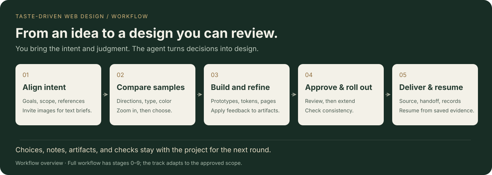

# Taste-Driven Web Design

**Make your taste the guiding thread of AI design.**

[中文](README.md) · English

`taste-driven-web-design` is a design skill for coding agents, covering websites, landing pages, application interfaces, visual redesigns, and product-wide rollouts. You bring goals and references, review samples, choose directions, and give feedback. The agent turns those choices into prototypes, design specifications, and actual source changes.

[See the experience](#how-you-take-part) · [Explore the workflow](#the-workflow) · [Get started](#get-started) · [Try the local demo](#try-the-decision-page) · [Review past choices](#review-a-completed-workflow)


*Screenshot of the built-in decision interface using a fictional reading product, “拾页” (Shiye). It shows direction selection and feedback entry, rather than a completed client project. The current interface is primarily in Chinese.*

## How you take part

| Step | Your judgment | The agent's work |
|---|---|---|
| Align the intent | Describe the goal and what you like or dislike in references | Identify concrete traits; invite reference images when the brief is text-only |
| Compare directions | Review actual samples, zoom or compare, choose, and leave notes | Build options around the confirmed intent and apply feedback to the next revision |
| Refine and approve | Review representative pages and stage results | Refine prototypes, tokens, assets, and details; advance after approval |
| Roll out and deliver | Review pages in scope and items requiring manual checks | Extend the design, check consistency, and deliver source changes and project records |

You can say “Keep B's editorial feel, but make the headline more restrained,” or explain why none of the options fits. You approve major aesthetic choices. Choices and notes stay with the project; the agent acknowledges an answer after applying it.


*Side-by-side comparison in the same demo project. The viewer supports 375 / 768 / 1440 viewport widths and reviewing previously answered options. These are demo samples; actual directions depend on your goals and the agent's work.*

## A good fit for

- **Finding a new product's direction.** Start with an idea and a few references, then decide on layout, type, color, and details.
- **Redesigning an existing product.** Agree on business and layout boundaries, capture the baseline, and compare the proposed design with the current interface.
- **Extending an approved page across a site.** Refine a representative page, roll it out to the agreed pages, and check assets and visual consistency.

## Highlights

- **Make visual choices with visual evidence.** Major aesthetic decisions use a page with image, HTML, or video samples, including zoom, side-by-side comparison, responsive previews, and decision history.
- **Agree on scope before exploring.** Establish whether the work is a new build or redesign, one page or a full site, and whether the layout should stay or change.
- **Approve work stage by stage.** Scripts check artifacts, decisions, and answer acknowledgements before advancing to the next stage in the selected track.
- **Turn references into concrete specifications.** Break film, game, or brand references into discussable traits, then translate them into typography, color, layers, assets, and motion requirements.
- **Keep decisions with the project.** Preserve original answers, notes, summary cards, briefs, and verification results. Record the source of new requirements and which earlier requirements they replace.
- **Recover long workflows.** A current-work record and a read-only recovery index locate the stage, outstanding answers, relevant files, and next action, reducing dependence on the full chat history.
- **Carry the direction through to delivery.** Cover representative-page refinement, site-wide rollout, asset consistency, optional appearance settings, and handoff instructions.

## The workflow



<details>
<summary>Expand all stages, from 0 to 9</summary>

| Stage | Work |
|---|---|
| 0 · Scope | Agree on pages, layout freedom, track, and appearance settings; capture the baseline for redesigns |
| 1 · Creative brief | Define goals, content, constraints, and reference traits; invite reference images and calibrate text-only intent |
| 2 · Information architecture | Use wireframes to review layout and information priorities |
| 3 · Visual exploration | Compare directions at different intensities, including at least one bold option |
| 4 · Prototype and asset specification | Build prototypes and establish asset benchmarks, layers, and interface states |
| 5 · Design tokens | Finalize typography, color, and other tokens; approve appearance presets and axes when applicable |
| 6 · Section refinement | Bring representative sections to finished quality |
| 7 · Site-wide rollout | Apply the approved design to all pages in scope |
| 8 · Quality checks | Review responsiveness, accessibility, assets, motion, project builds, and other agreed checks |
| 9 · Delivery | Deliver source changes, design documentation, and manual handoff steps with verification methods |

</details>

The track adapts to the approved scope. Keeping the existing layout omits wireframes; a single-page project omits site-wide rollout. The fast track merges visual exploration into the brief approval, and the token stage can be skipped when eligible and approved. See [stages and change management](references/workflow.md) for the exact rules.

## Get started

You need an agent that can read skill files, edit a project, and execute commands, plus Python 3. The stage controller and decision server use only the Python standard library. Screenshots, sample checks, and theme matrices use Playwright, Pillow, or ffmpeg as needed. Image search or generation requires corresponding capabilities from the host.

The recommended installation uses the [Skills CLI](https://github.com/vercel-labs/skills) and requires Node.js and `npx`:

```bash
npx skills add leungingit/taste-driven-web-design
```

Follow the prompts to select your target agent. Installation is project-local by default; append `-g` to install to your user directory for use across projects.

<details>
<summary>Alternatively, clone into a skill directory manually</summary>

Place this repository in a skill directory supported by your host. For example, environments using `~/.agents/skills/` can run:

```bash
git clone https://github.com/leungingit/taste-driven-web-design.git \
  ~/.agents/skills/taste-driven-web-design
```

</details>

Skill discovery and activation depend on the host. Once it can read [SKILL.md](SKILL.md), explicitly invoke the skill in your target project and describe your goals, scope, and references. For example:

```text
Use taste-driven-web-design to redesign this project.
Start with a homepage sample, then roll out the approved direction to other pages.
Preserve the existing business logic. Aim for a warm editorial feel.
Confirm scope and references with me first, and show samples for major aesthetic choices.
```

The agent initializes the project records, creates decisions, and follows the workflow. The default channel is a local decision webpage. Before waiting on each new batch, the agent must send a chat message with the actual page address, the decisions awaiting your input, and submission instructions. When a local server is unavailable, the protocol selects an inline or static channel according to the host's capabilities. You answer decisions and approve results; you do not need to send a separate “continue” message after each stage.

A text-only starting point such as “futuristic” or “warm editorial design” is welcome. The agent first invites 1–3 reference images. You can supply images, ask the agent to find candidates, or explicitly continue with text and confirm the interpretation through visual options.

### Try the decision page

To explore the interface before using the full skill, run this from the repository root:

```bash
python3 docs/demo/serve.py
```

Open the local address printed in the terminal to view, compare, and submit a demo choice. Only Python 3 is required; no model API key is needed. The demo uses a temporary directory that is removed after `Ctrl+C`. It demonstrates the decision interface without an agent applying answers or creating subsequent designs. Add `--port 0` to select an available port automatically. See the [demo notes](docs/demo/README.md) (Chinese) for asset details and screenshot reproduction.

## Project records and recovery

Design process files live in `.taste-design/` inside the target project. Finished code goes into the project's actual source locations.

```text
.taste-design/
├── record/   # State, scope, briefs, decisions, new requirements, and current work
├── work/     # Wireframes, directions, prototypes, tokens, QA, and handoff documents
├── media/    # Images, videos, samples, and screenshots
└── cache/    # Runtime files, source snapshots, and temporary output
```

`record/` and `work/` are intended to stay with the project. `media/` is ignored by default and can instead use Git LFS or ordinary commits. `cache/` is not committed. Committing requires the user's authorization.

To recover, run the following from the target project's root, replacing the example path with the actual skill location:

```bash
skill_dir="/path/to/taste-driven-web-design"
python3 "$skill_dir/scripts/gate.py" context --json
```

This command only returns a recovery index. It does not acknowledge answers or advance stages. The agent must read the relevant records, inspect actual artifacts, and then obtain complete answers through `next --json` before continuing. See the [context and recovery protocol](references/continuity.md).

### Syncing across machines and media policies

**The default `media: ignore` policy does not guarantee complete visual review on another machine.** After committing and pulling `record/`, questions, option text, choices, and notes remain available. Uncommitted originals, screenshots, and videos in `media/` do not travel with Git; HTML samples in `work/` that reference them will also lack those assets. Summary thumbnails are available only if successfully generated and committed. They cannot replace full assets, and the decision page does not automatically substitute thumbnails for missing originals.

| Policy | How assets reach another machine | Suitable for |
|---|---|---|
| `ignore` (default) | Git carries text records; complete review requires separately syncing `media/` with its directory structure intact | Local-only assets or an existing file-sync process |
| `commit` | Assets travel with ordinary Git commits, pushes, and pulls | Smaller asset collections requiring complete review or continued design work |
| `lfs` | Git LFS carries assets; both machines need LFS configured and the actual objects downloaded | Larger image/video collections requiring full preservation |

On the **machine that still has the complete original assets**, run this from the target project's root to switch to ordinary Git tracking:

```bash
skill_dir="/path/to/taste-driven-web-design"
python3 "$skill_dir/scripts/gate.py" media commit
```

For LFS, configure Git LFS first and replace the command's final argument, `commit`, with `lfs`. Switching only updates configuration and Git rules; it does not commit, push, or recover missing assets. After user authorization, commit and push the required records, design artifacts, media, and policy files. Pull them on the other machine and check the actual files; LFS projects also need the asset objects downloaded. If keeping `ignore`, sync the required assets separately.

`cache/` remains uncommitted. Restart the decision service or export the static page on the other machine to recreate the corresponding runtime files. Neither action automatically bundles or downloads missing assets.

### Review a completed workflow

From the project you want to review, replace `skill_dir` with the installed skill directory containing `SKILL.md` and `scripts/`, then run:

```bash
skill_dir="/path/to/taste-driven-web-design"
python3 "$skill_dir/scripts/decide_server.py" serve
```

The command starts the server and prints its address; it does not open a browser automatically. With the default port, open [decision history](http://localhost:8765/#review) to go directly to the review tab. For another port, append `#review` to the actual address. If the server is already running for the same project, open its address without starting a second instance. Press `Ctrl+C` to stop the server.

Filter by stage, search titles/options/notes, and inspect every answered question's options, samples, final choice, notes, and answer time. Samples support zoom and side-by-side comparison. Reviewing is read-only: it does not restart a completed workflow or edit historical answers. Design changes require the agent to follow the change-management procedure. Before archiving or moving a project, preserve its records and sample files as described in [syncing across machines and media policies](#syncing-across-machines-and-media-policies).

To review without keeping a server running, export a static snapshot from the same project:

```bash
python3 "$skill_dir/scripts/decide_server.py" export
```

Open `.taste-design/cache/export/index.html` in a browser and select the review tab, or append `#review` to the file address. The static page still references the project's sample files; the HTML alone is not a complete offline archive.

## Repository guide

| Entry | Contents |
|---|---|
| [SKILL.md](SKILL.md) | Agent entry point and execution contract |
| [references/](references/) | Stage instructions, decision protocol, runtime rules, and recovery procedures |
| [scripts/](scripts/) | Stage gates, decision server, validation, and media tools |
| [templates/](templates/) | Direction page, theme gallery, asset comparison, and current-work templates |
| [tests/](tests/) | Regression tests for progression, answer replay, waiting, and recovery |

Run tests from this repository's root:

```bash
python3 -B -m unittest discover -s tests -p 'test_*.py' -v
```

## Operating boundaries

This skill supplies a workflow, tools, and recording protocols. Results depend on the agent, available assets, and verification environment. Stage checks do not replace reviewing the design itself. Whether a fresh session correctly recovers design trade-offs must be verified on a real project using the recovery protocol.

By default, the agent waits for answers in bounded segments within an active turn. A running local server does not automatically wake an agent whose turn has ended. Optional Claude Code hooks must be validated in the actual host before relying on them. Checks that require a physical device must be explicitly listed at handoff. See the [runtime protocol](references/runtime.md).

The skill specification, built-in decision interface, and detailed reference documents are currently primarily in Chinese. This page is an English introduction to the project.
