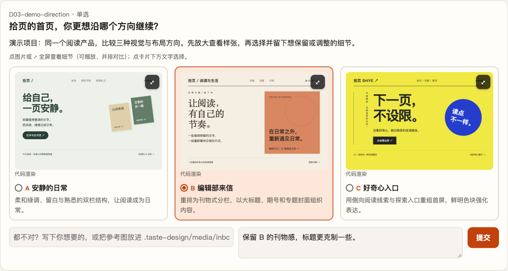
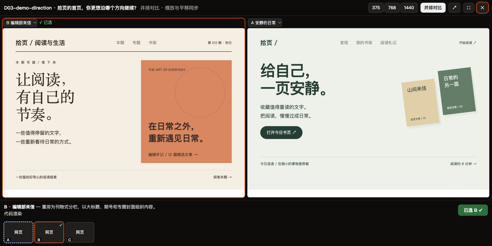
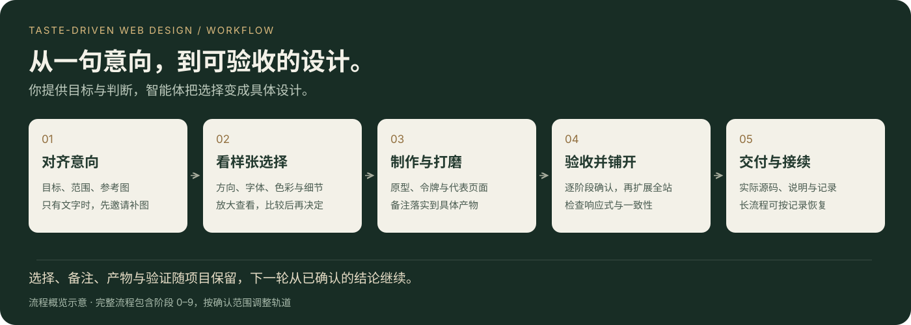

# Taste-Driven Web Design

**让你的审美，成为 AI 设计的主线。**

中文 · [English](README.en.md)

`taste-driven-web-design` 是一套面向编程智能体的设计技能，适用于网站、落地页和应用界面的新建、视觉改版及全站铺开。你提供目标与参考，看样张、选方向、留反馈；初始阶段选择交付边界，智能体据此交付设计系统与工作原型，或同时修改当前工程实现。

[看使用过程](#你会如何参与) · [了解流程](#设计流程) · [开始使用](#开始使用) · [本地体验演示](#先体验决策页) · [回顾历史选择](#回顾已完成的流程)



*内置决策页的真实界面截图，使用虚构阅读产品「拾页」的演示数据。图中展示方向选择与备注输入，不代表真实项目的最终交付。*

## 你会如何参与

| 过程 | 你来判断 | 智能体来落实 |
|---|---|---|
| 对齐意向 | 说明目标，提供喜欢与不喜欢的参考 | 拆解整体气质与具体特征；首次开放决策页前，只有文字时先邀请补图 |
| 比较方向 | 看实际样张，放大或并排对比，选择并留备注 | 根据已确认意向制作方案，把反馈落实到下一版 |
| 打磨与验收 | 确认代表页面和阶段成果 | 完善原型、令牌、资产与细节，通过验收后推进 |
| 铺开与交付 | 验收本期页面及需要人工复核的事项 | 扩展到确认范围，检查一致性，按交付边界交付设计成果或源码 |

你可以说“保留 B 的刊物感，标题更克制一些”，也可以指出“这些都不贴近我的目标”。主要审美选择由你确认，选择和备注随项目保存；用户答案落实后，智能体才确认处理完成。



*同一演示项目的并排对比截图。查看器支持 375 / 768 / 1440 宽度切换，也能回看已经作答的选项。图片中的样张是演示素材，实际方案由智能体结合你的目标制作。*

## 适合这些设计任务

- **给新产品找方向**：从一句意向和几张参考图出发，逐步确定布局、字体、配色与细节。
- **为已有产品改版**：先确认业务与布局边界，记录现状，再比较新视觉与原界面。
- **把一个好页面铺开到全站**：先做代表页面，确认后应用到本期页面，并检查资产与风格一致性。

## 核心特点

- **看着样张做决定**：主要审美选择通过带图片、HTML 或视频样张的决策页完成；支持放大、并排对比、响应式预览和历史回顾。
- **先确认范围，再制作方案**：区分新建与改版、单页与全站、保留布局与结构重排，并单独确认是否修改当前工程实现。
- **逐阶段验收**：脚本检查产物、决策和答案确认状态；通过当前闸门后，才推进实际后继阶段。
- **参考转化为具体规格**：把影视、游戏、品牌等参考拆成可讨论的特征，逐步落实为字体、配色、图层、素材和动效要求。
- **记录可以随项目保留**：保存决策原文、备注、摘要卡、简报和验证结果；新要求明确记录来源及替代关系。
- **长流程可以恢复**：用当前工作记录和只读恢复索引定位阶段、待处理答案、相关文件及下一步，减少对完整聊天历史的依赖。
- **从样张扩展到成品**：覆盖代表页面打磨、全站铺开、资产一致性、可选主题设置及最终交付说明。

## 设计流程



<details>
<summary>展开完整的 0–9 阶段与工作内容</summary>

| 阶段 | 工作 |
|---|---|
| 0 · 启动与范围 | 确认交付边界、页面、布局自由度、轨道及外观设置；改版先记录现状 |
| 1 · 创意简报 | 整理目标、内容、约束和参考特征；复用启动前素材准备，通过带图选项校准理解 |
| 2 · 信息架构 | 用灰模确认布局与信息优先级 |
| 3 · 视觉发散 | 比较不同力度的方向，包含至少一个大胆方案 |
| 4 · 原型与资产规范 | 制作原型，确定资产基准、图层和状态要求 |
| 5 · 设计令牌 | 定稿字体、颜色和其他令牌；有主题设置时确认预设与维度 |
| 6 · 区块打磨 | 将代表性局部推进到成品质量 |
| 7 · 全站铺开 | 覆盖本期全部页面；仅设计制作原型，设计并实施改造工程 |
| 8 · 质量检查 | 检查响应式、可访问性、资产和动效；实施模式补充工程测试与构建 |
| 9 · 交付 | 按边界交付设计系统与原型，或实际源码；说明验证方法，仅设计最后建议是否关联项目文档 |

</details>

流程按已确认范围调整：保留布局时省略灰模，单页项目省略全站铺开；快速轨道将视觉发散并入简报验收，设计令牌阶段在符合条件且获批后可跳过。详细规则见 [阶段与变更管理](references/workflow.md)。

### 初始阶段选择交付边界

阶段 0 会单独询问「本期是否同时修改当前工程实现」，两项都需要用户亲自选择，不默认推断：

| 选择 | 交付与修改范围 |
|---|---|
| 设计并修改工程实现 | 交付原型、规范与实际源码，并验证工程测试和构建 |
| 仅设计系统与工作原型 | 原型、令牌、资产和规范保存在设计目录；不自动修改工程及项目文档，正式实施另行安排 |

题目使用 `role=delivery-boundary`，答案写入 `scope.json.delivery_mode`；回顾页、摘要卡和静态导出都能看到选项与选择。每一期分别确认，改变边界需要回退到阶段 0 重新选择。

仅设计交付的最后会建议是否将设计系统的入口、适用范围和约束关联到项目文档；不要求先答复才能完成设计。用户另行同意并记录 `role=documentation-sync` 后，才更新 `AGENTS.md`、`docs/design-system.md`，这项选择同样可以回顾。

门禁会检查用户答案与范围一致，并固定决策版本。仅设计时根据初始化的工程指纹检查新增、删除、内容和权限变化，拒绝越界过闸；已启用的写入 hook 额外做事前拦截。指纹以工作区现状为准，包含原有未提交代码；只保存摘要，不复制源码。排除目录、并发改动处理与旧项目兼容说明见 [阶段 0](references/stage-0.md)。这些检查属于流程护栏，不能替代操作系统写入隔离。

## 开始使用

需要能读取技能文件、编辑项目并执行命令的智能体，以及 Python 3。阶段状态机和决策服务只使用 Python 标准库；截图、样张检查和主题矩阵等功能按需要使用 Playwright、Pillow 或 ffmpeg。查找图片或生成图片还需要宿主提供相应能力。

推荐使用 [Skills CLI](https://github.com/vercel-labs/skills) 安装，需要 Node.js 和 `npx`：

```bash
npx skills add leungingit/taste-driven-web-design
```

按提示选择目标智能体。默认安装到当前项目；希望跨项目使用时，在命令末尾追加 `-g` 安装到用户目录。

<details>
<summary>也可以手动克隆到技能目录</summary>

将仓库放入宿主支持的技能目录。例如，使用 `~/.agents/skills/` 的环境可以运行：

```bash
git clone https://github.com/leungingit/taste-driven-web-design.git \
  ~/.agents/skills/taste-driven-web-design
```

</details>

技能发现与启用方式由宿主决定。确认能读取 [SKILL.md](SKILL.md) 后，在目标项目中明确调用技能，并给出目标、范围与参考，例如：

```text
使用 taste-driven-web-design 改版这个项目。
先做首页样张，确认后铺开到其他页面。
保留现有业务逻辑；视觉想要温暖的编辑设计感。
先与我确认范围和参考，不确定的主要审美选择请提供样张。
```

智能体会按协议初始化项目、建立决策并推进流程。默认通过本地网页展示选项；每批决策开放后，智能体先在对话中告知实际地址、待决定项和提交方式，再开始等待。没有本地服务能力时，按宿主能力选择内嵌或静态通道。你负责作答和验收，无需逐阶段发送“继续”。

暂时只有“未来感”“温暖的编辑设计感”等文字也可以开始。智能体会在首次开放决策页之前邀请你补充 1–3 张目标参考图；你可以补图、委托找图，或明确选择继续用文字，再通过带图选项确认理解。

### 先体验决策页

想先看看选择方案的实际操作，可以在本仓库根目录运行：

```bash
python3 docs/demo/serve.py
```

打开终端打印的本地地址，即可查看、对比并提交演示选择。只需要 Python 3，无需模型密钥。演示使用临时目录，按 `Ctrl+C` 关闭后清理；它只展示决策界面，没有智能体接手答案或生成后续设计。端口冲突时可加 `--port 0` 自动分配。素材说明与截图复现见 [演示说明](docs/demo/README.md)。

## 项目记录与恢复

单期设计过程保存在目标项目的 `.taste-design/`。选择设计并实施时，成品代码写入项目实际源码位置；仅设计时保留设计系统与工作原型，用户可另行选择关联项目文档。

```text
.taste-design/
├── record/   # 状态、范围、简报、决策、补充要求与当前工作记录
├── work/     # 灰模、方案、原型、令牌、质检与交付文档
├── media/    # 图片、视频、样张与截图
└── cache/    # 运行时文件、源码快照与临时输出
```

`record/` 和 `work/` 用于随项目保存；`media/` 默认不提交，可切换为 Git LFS 或直接提交；`cache/` 不提交。提交由用户授权后执行。

同一产品需要一期、二期、三期时，每一期使用独立的设计流程实例，共享跨期稳定的品牌与设计系统：

```text
.taste-design/
├── project.json                    # 期列表、父期与显式继承
├── phases/
│   ├── P1-foundation/{record,work,media,cache}/
│   └── P2-account/{record,work,media,cache}/
└── shared/
    ├── brand.md
    └── design-system/
```

```bash
skill_dir="/path/to/taste-driven-web-design"
python3 "$skill_dir/scripts/gate.py" init --phase P1 --name "第一期"
python3 "$skill_dir/scripts/gate.py" phase add P2 --name "第二期" \
  --parent P1 --inherit shared/brand.md
python3 "$skill_dir/scripts/gate.py" phase list --json
python3 "$skill_dir/scripts/gate.py" --phase P2 context --json --compact
```

每期的阶段、范围、答案、验收和当前工作完全隔离；P1 通过不会自动把 P2 标成已验收。多期项目存在多个实例时必须用 `--phase` 或 `TASTE_DESIGN_PHASE` 明示当前期，脚本不会猜“最新一期”。`shared/` 只放跨期稳定、已确认的品牌和设计系统，不放某期的进度或历史归档。

`--root` 可以指向项目、`.taste-design/` 或具体期；显式 `--phase` 优先于路径所在期。已经位于某一期目录内且未指定 `--phase` 时，沿用该目录所属期。`init --phase P2` 同样可以追加新期；已有期的状态不会被复制到新期。

恢复时，在目标项目根目录运行以下命令，将示例路径换成实际技能路径：

```bash
skill_dir="/path/to/taste-driven-web-design"
python3 "$skill_dir/scripts/gate.py" context --json --compact
```

该命令只输出恢复入口：当前期、流程状态、工作记录是否可用、继承文件是否缺失、记录缺失及分页入口。需要诊断时再运行不带 `--compact` 的 `context --json`，或按 `--section` 分页。预览截短会明确标记，不确认答案或推进阶段。智能体优先核对当前任务、有效约束和直接依赖，缺少 `record/progress.md` 时先按事实补建；定位后执行一个小步骤，不重读全部历史、图片或脚本源码。待落实答案仍通过 `next --json` 完整读取。详见 [上下文与恢复协议](references/continuity.md)。

### 减少 token 消耗

- 恢复先运行 `context --json --compact`；只在需要诊断时用完整概览。多期项目按 `--phase` 只载入当前期。
- 按职责读取 `progress.md`、`scope.json`、`constraints.yaml` 和当前阶段说明；历史用决策 ID 与摘要卡定位，不遍历全部答案或样张。
- 图片先看摘要缩略图或决策页对比视图；只在判断纹理、细节或修复像素时读取原图。
- 每轮只开放 2–3 个确实需要用户判断的决策；可推导的次要事项用 `assume` 记录，随阶段验收一次确认。
- `progress.md` 保持精简并覆盖更新；历史证据改为链接或 ID，不把工作记录写成聊天日志。
- 工具输出优先用定点搜索、段落读取、分页和错误摘要，不重复粘贴完整 JSON 或长文件。

`--compact` 只减少重复索引，不省略待落实答案与硬约束；完整输出仍可按需获取。

继承清单也按 `--limit` 分页，默认首屏 5 项；查看余项用 `context --json --section inherited --offset 5`，并按返回的 `next_offset` 续读。`next --json` 在 `new` 中完整交付答案，省略重复的 `new_text` 文字摘要；非 JSON 输出和等待 hook 仍保留摘要。字符量对照与回归结果见[多期与输出量验证记录](docs/verification-multi-phase.md)。

### 跨机器同步与素材策略

**默认的 `media: ignore` 不能保证另一台机器完整回顾视觉样张。** 提交并拉取 `record/` 后，题目、选项文字、选择和备注仍可查看；但 `media/` 中未提交的原图、截图和视频不会随 Git 同步，`work/` 中引用它们的 HTML 样张也会缺少素材。摘要缩略图仅在成功生成并提交后可用，不能替代完整素材，决策页也不会自动用缩略图补齐缺图。

| 策略 | 跨机器同步方式 | 适用情况 |
|---|---|---|
| `ignore`（默认） | Git 同步文字记录；完整回顾需另外同步 `media/` 并保留目录结构 | 素材只留本机，或已有独立文件同步 |
| `commit` | 素材随普通 Git 提交、推送和拉取 | 素材较少，需要完整回顾或接续设计 |
| `lfs` | 用 Git LFS 同步素材；两台机器均需配置 LFS 并下载实际对象 | 图片、视频较多，需要完整保留素材 |

在**原始素材仍完整的机器**上，进入目标项目根目录，按需切换策略，例如改为普通 Git 管理：

```bash
skill_dir="/path/to/taste-driven-web-design"
python3 "$skill_dir/scripts/gate.py" media commit
```

需要 LFS 时，先配置 Git LFS，再将上面命令的最后一个参数 `commit` 改为 `lfs`。切换只更新配置与 Git 规则，不会自动提交、推送或补回缺失素材；经用户授权后，还需将所需的记录、设计稿、素材及策略文件提交并推送，另一台机器拉取后核对原文件是否齐全，LFS 项目还需下载实际素材对象。保留 `ignore` 时，另行同步完整的相关素材。

`cache/` 仍不提交；在另一台机器重新启动决策服务或导出静态页即可重建相应运行文件。启动服务和静态导出都不会自动打包或下载缺失素材。

### 回顾已完成的流程

在要回顾的项目根目录运行，将 `skill_dir` 换成实际安装的技能目录（包含 `SKILL.md` 和 `scripts/`）：

```bash
skill_dir="/path/to/taste-driven-web-design"
python3 "$skill_dir/scripts/decide_server.py" serve
```

命令会启动服务并打印地址，不会自动打开浏览器。默认端口下打开 [历史回顾](http://localhost:8765/#review)，即可直接进入「回顾」标签；如果指定了其他端口，在实际地址后加 `#review`。原服务仍在运行且对应同一项目时，直接访问即可，无需重复启动。按 `Ctrl+C` 关闭服务。

回顾页支持按阶段筛选、搜索标题/选项/备注，查看已作答题目的全部选项、样张、最终选择、备注和作答时间，也能放大及并排对比。回顾本身只读，不会重新执行已完成流程或修改历史答案；要调整设计，需另行让智能体按变更流程处理。归档或迁移项目时，先按[跨机器同步与素材策略](#跨机器同步与素材策略)保留记录及样张原文件。

不想常驻服务时，也可以在同一项目根目录导出当前记录的静态快照：

```bash
python3 "$skill_dir/scripts/decide_server.py" export
```

用浏览器打开生成的 `.taste-design/cache/export/index.html`，切到「回顾」（或在文件地址后加 `#review`）。静态页仍引用项目里的样张文件，不能只复制这个 HTML 就当作完整离线档案。

## 仓库导航

| 入口 | 内容 |
|---|---|
| [SKILL.md](SKILL.md) | 智能体执行入口与完整流程契约 |
| [references/](references/) | 分阶段说明、决策协议、运行与恢复规则 |
| [scripts/](scripts/) | 阶段闸门、决策服务、验证及素材工具 |
| [templates/](templates/) | 方案页、主题画廊、资产对比和工作记录模板 |
| [tests/](tests/) | 状态推进、答案重交、等待和恢复等回归测试 |

在本仓库根目录运行测试：

```bash
python3 -B -m unittest discover -s tests -p 'test_*.py' -v
```

## 使用边界

这套技能提供流程、工具和记录协议，实际效果仍取决于智能体、素材与验证环境。阶段检查不能替代对设计内容的审阅；独立会话能否正确恢复设计取舍，需要按协议在真实项目上验证。

默认在活跃回合内分段等待用户作答。本地服务存活不代表已结束的智能体回合会自动唤醒；可选的 Claude Code hook 也必须经过真实宿主验证后才能依赖。需要人工设备验证的项目应在交付时明确列出。详见 [运行协议](references/runtime.md)。

当前技能规范、内置决策页和详细参考文档以中文为主；本页提供 [英文项目介绍](README.en.md)。
